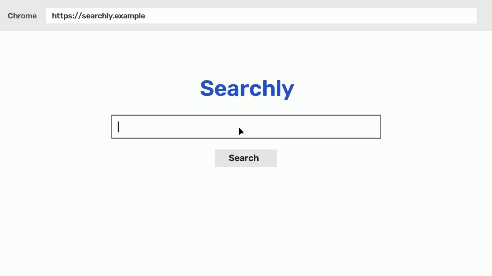
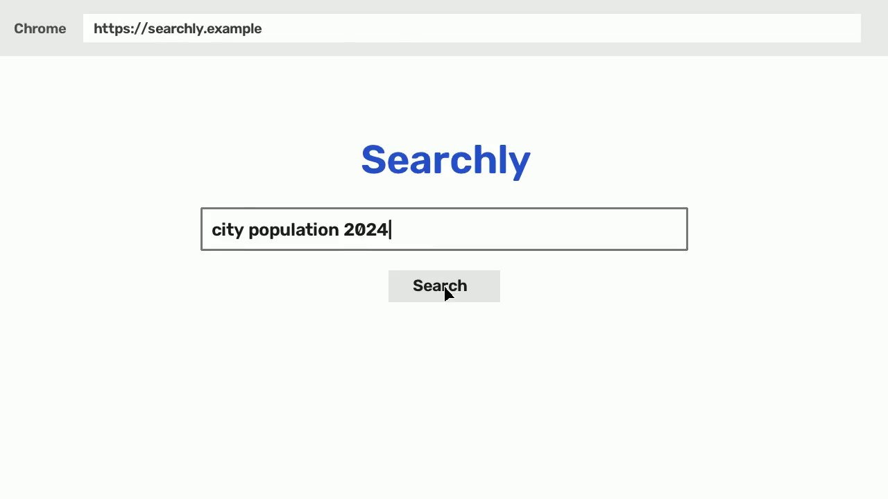
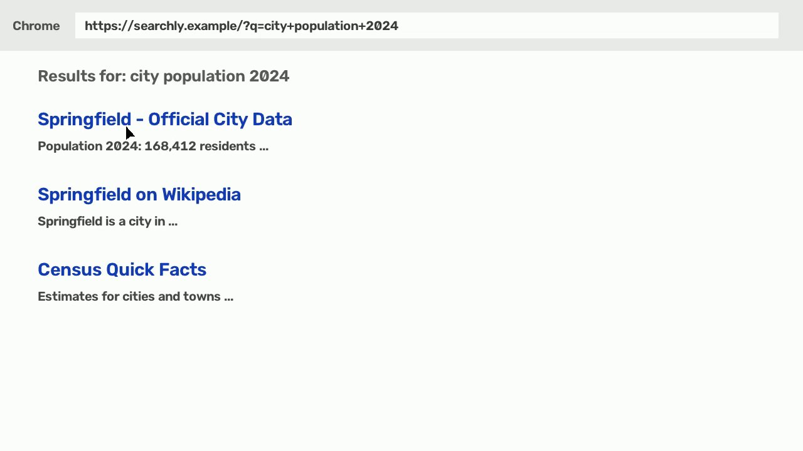
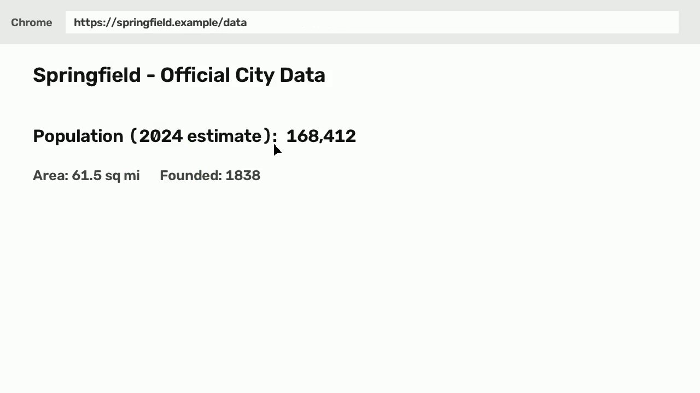
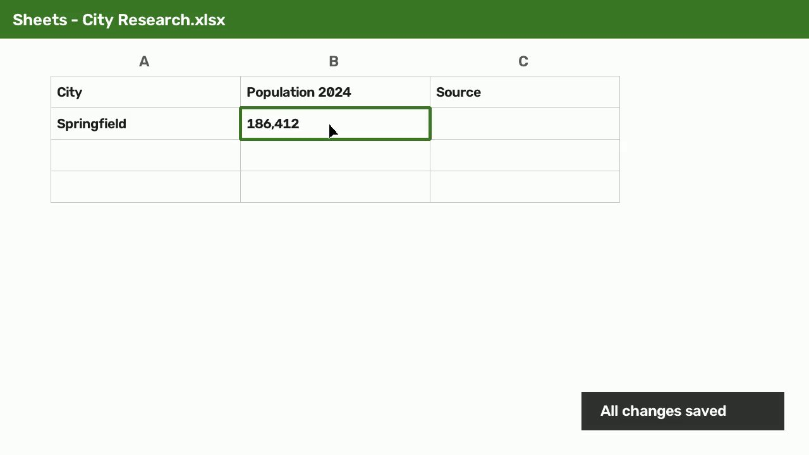

# Research and Record City Population Data

**Goal:** Find the 2024 population estimate for a specific city online and record it in a research spreadsheet.

The workflow involves searching for city population data using a web browser, navigating to an official data source, and transcribing the identified value into a specific cell in an Excel spreadsheet.

| | |
|---|---|
| **Recording** | [recording.mp4](recording.mp4) (00:00:20) · [interactive viewer](playbook.html) |
| **Source** | imported video (visual only) |
| **Apps / sites** | Chrome, Sheets |
| **Steps** | 4 |
| **Model** | gemini-3-flash-preview |
| **Generated** | 2026-10-24T14:59:23 |

## Review summary

⚠️ **1 of 4 steps need human review:**

- [Step 4: Record population in spreadsheet](#step-4) at 00:00:09 (Check)

> ℹ️ Built from an imported video without mouse/keyboard data; confidence is lower and more steps are flagged.

## Prerequisites

- Access to a web browser with internet connectivity
- Access to the 'City Research.xlsx' spreadsheet

## Inputs

Values that will likely change each time this playbook is used:

| Input | Example from recording | Description |
|---|---|---|
| `search_query` | city population 2024 | The query used to find population data. |
| `city_name` | Springfield | The name of the city being researched. |
| `spreadsheet_file` | City Research.xlsx | The name of the spreadsheet file where data is recorded. |
| `target_cell` | B2 | The specific cell where the population value should be entered. |

## Steps

### Step 1: Search for city population data

[00:00:00](recording.mp4#t=0) – 00:00:05 · 🟢 0.80

In Chrome, type 'city population 2024' into the Searchly search bar and click the 'Search' button.

- **App:** Chrome - Searchly
- **Action:** type
- **Target:** Search
- **Value:** city population 2024
- **Expected result:** Search results for the query are displayed.

Screenshots

<b>Before</b>  
<b>After</b>  

### Step 2: Navigate to official city data

[00:00:05](recording.mp4#t=5) · 🟢 0.80

Click on the first search result link titled 'Springfield - Official City Data'.

- **App:** Chrome - Searchly
- **Action:** click
- **Target:** Springfield - Official City Data
- **Expected result:** The browser navigates to the official city data page for Springfield.

Screenshots

<b>Before</b>  
<b>After</b>  

### Step 3: Identify the 2024 population estimate

[00:00:06](recording.mp4#t=6) – 00:00:09 · 🟢 0.90

Locate and read the population estimate for 2024 on the city data page.

- **App:** Chrome - https://springfield.example/data
- **Action:** read
- **Target:** Population (2024 estimate):
- **Value:** 168,412
- **Expected result:** The population value '168,412' is identified.

Screenshots

<b>Before</b>  
<b>After</b>  

### Step 4: Record population in spreadsheet

[00:00:09](recording.mp4#t=9) – 00:00:18 · 🔎 0.80

Switch to the 'City Research.xlsx' spreadsheet and type the population value into cell B2 for Springfield, then wait for the 'All changes saved' confirmation.

- **App:** Sheets - City Research.xlsx
- **Action:** type
- **Target:** Cell B2
- **Value:** 186,412
- **Expected result:** The value is entered and the spreadsheet confirms the changes are saved.

> ⚠️ **NEEDS REVIEW** (0.80)
> - Check: The value entered '186,412' differs from the value read '168,412' in the previous step, suggesting a transcription error.
>
> *Evidence:* [00:00:13] shows the spreadsheet application in focus. | The user typed '186,412' in cell B2 ([00:00:17]), which is a typo compared to the source value '168,412' seen in [00:00:09]. | [00:00:18] shows a toast notification at the bottom right stating 'All changes saved'.
>
> *Confidence adjustments:* Imported video: no input events recorded, so the action is inferred from visual change only
>
> - [ ] Verified by a human against the recording at [00:00:09](recording.mp4#t=9)

Screenshots

<b>Before</b>  
<b>After</b>  

## Open questions

Things the system could not infer from the recording:

- Should the population value '186,412' be corrected to '168,412' in the spreadsheet to match the source data?

---
*Generated from a screen recording. ⚠️ marks steps below a confidence of 0.70; 🔎 marks steps that were understood but look worth double-checking. Verify both against the recording before relying on this playbook.*
