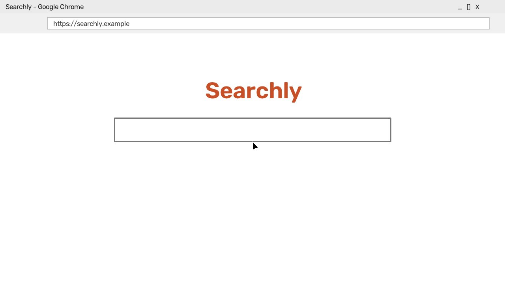
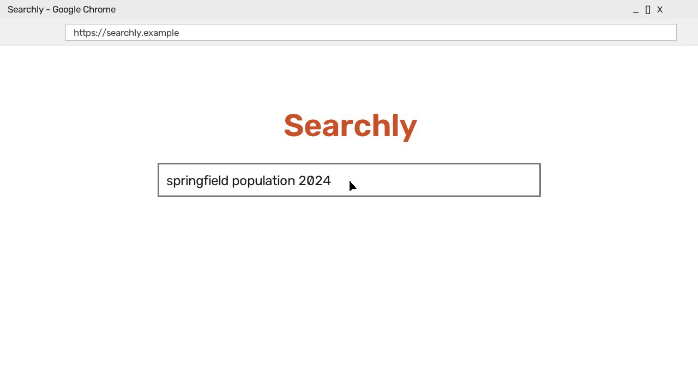
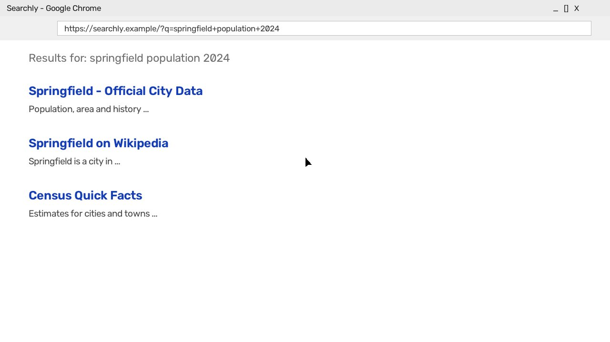
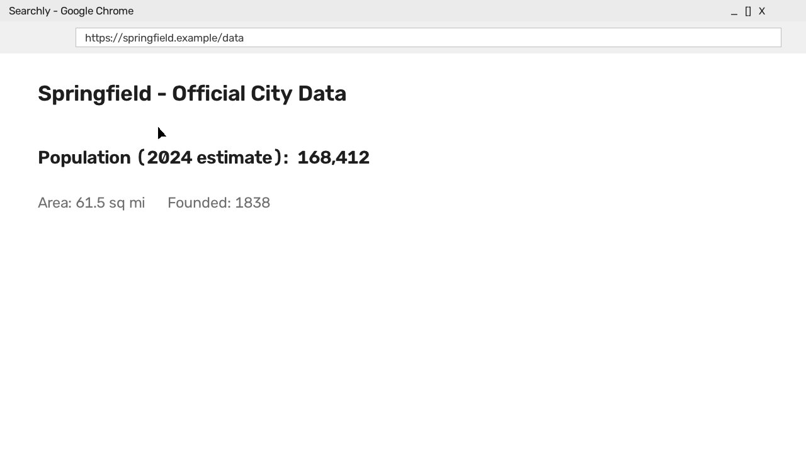
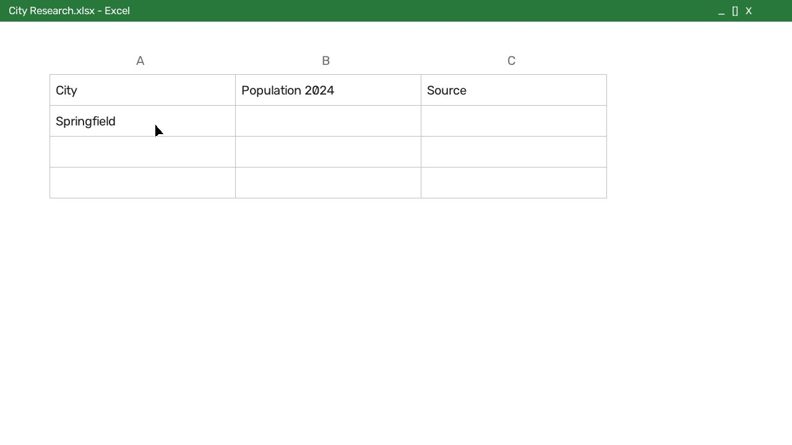
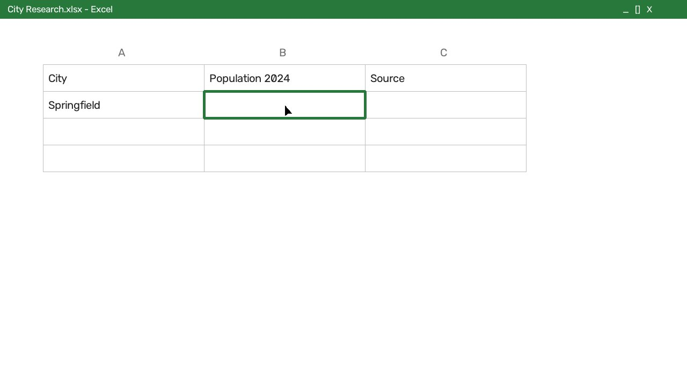
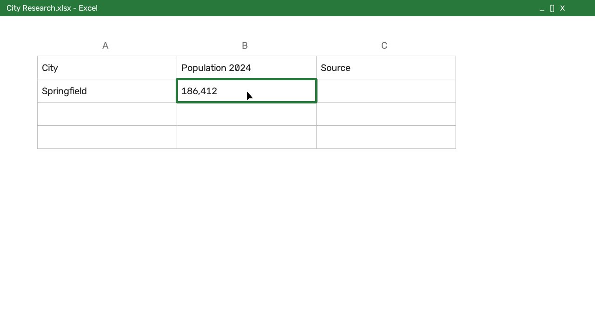
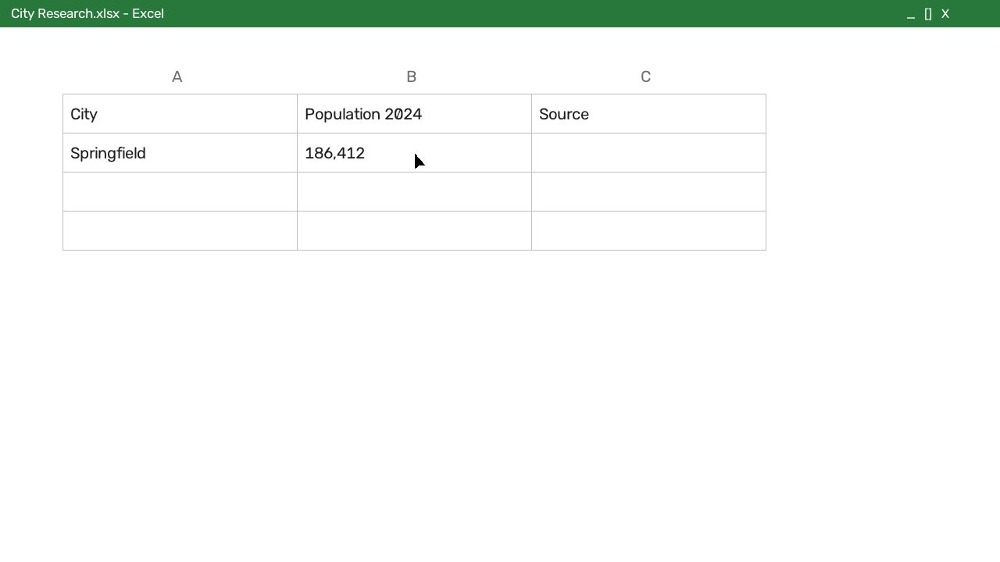

# Search for Springfield Population and Enter into Excel

**Goal:** Search for Springfield's population in 2024 on the Searchly website, retrieve the data, and enter it into an Excel spreadsheet.

The workflow begins by searching for Springfield's population in 2024 on the Searchly website. The results are accessed, and the data is then transferred to Excel. The user enters the population value 186,412 into the appropriate cell in the spreadsheet.

| | |
|---|---|
| **Recording** | [recording.mp4](recording.mp4) (00:00:23) · [interactive viewer](playbook.html) |
| **Source** | live capture (screen + input events) |
| **Apps / sites** | Searchly - Google Chrome, Excel |
| **Steps** | 8 |
| **Model** | qwen3-vl-2b |
| **Generated** | 2026-10-28T19:38:16 |

## Review summary

⚠️ **1 of 8 steps need human review:**

- [Step 7: Type '186,412' into the selected cell](#step-7) at 00:00:17 (Check)

## Prerequisites

- The user has access to the Searchly website and the Excel application.
- The file 'City Research.xlsx' is available and loaded in Excel.

## Inputs

Values that will likely change each time this playbook is used:

| Input | Example from recording | Description |
|---|---|---|
| `population_value` | 186,412 | The population value for Springfield in 2024 that is to be entered into the Excel cell. |
| `file_name` | City Research.xlsx | The Excel file containing the data about Springfield. |
| `city_name` | Springfield | The city name used in the data entry process. |
| `source_url` | https://searchly.example/?q=springfield+population+2024 | The URL of the search results page from Searchly. |

## Steps

### Step 1: Click on the search bar in Searchly

[00:00:01](recording.mp4#t=1) · 🟢 0.90

Click on the search bar in the Searchly website to focus on it.

- **App:** Searchly - Google Chrome
- **Action:** click
- **Target:** Searchly - Google Chrome
- **Value:** Searchly
- **Expected result:** The search bar is focused and ready for input.

Screenshots

<b>Before</b>  
<b>After</b>  

### Step 2: Type 'springfield population 2024' into the search bar

[00:00:01](recording.mp4#t=1) – 00:00:07 · 🟢 0.90

Type 'springfield population 2024' into the search bar.

- **App:** Searchly - Google Chrome
- **Action:** type
- **Target:** Searchly - Google Chrome
- **Value:** springfield population 2024
- **Expected result:** The search bar contains the text 'springfield population 2024'.

Screenshots

<b>Before</b>  
<b>After</b>  

### Step 3: Press Enter to execute the search

[00:00:07](recording.mp4#t=7) · 🟢 0.90

Press Enter to execute the search query for 'springfield population 2024'.

- **App:** Searchly - Google Chrome
- **Action:** press enter
- **Target:** Searchly - Google Chrome
- **Value:** springfield population 2024
- **Expected result:** The search results for 'springfield population 2024' are displayed on the page.

Screenshots

<b>Before</b>  
<b>After</b>  

### Step 4: Click on the 'Springfield - Official City Data' link

[00:00:09](recording.mp4#t=9) · 🟢 0.90

Click on the 'Springfield - Official City Data' link in the Searchly search results to open the page.

- **App:** Searchly
- **Action:** click
- **Target:** Springfield - Official City Data
- **Value:** Springfield - Official City Data
- **Expected result:** The page displays the city's data, including population, area, and founding year.

Screenshots

<b>Before</b>  
<b>After</b>  

### Step 5: Switch to Excel application

[00:00:13](recording.mp4#t=13) · 🟢 0.90

Switch to the Excel application from the current window.

- **App:** Excel
- **Action:** switch_app
- **Target:** City Research.xlsx - Excel
- **Value:** City Research.xlsx - Excel
- **Expected result:** The Excel window opens with the 'City Research.xlsx' file loaded, and the data from the Searchly page is ready to be entered.

Screenshots

<b>Before</b>  
<b>After</b>  

### Step 6: Click on the 'Population 2024' cell for Springfield in Excel

[00:00:15](recording.mp4#t=15) · 🟢 0.90

Click on the cell in the 'Population 2024' column for Springfield in the Excel table.

- **App:** Excel - City Research.xlsx
- **Action:** click
- **Target:** Cell in the 'Population 2024' column for Springfield
- **Value:** 186,412
- **Expected result:** The cell is selected and ready for input.

Screenshots

<b>Before</b>  
<b>After</b>  

### Step 7: Type '186,412' into the selected cell

[00:00:17](recording.mp4#t=17) – 00:00:19 · 🔎 0.90

Type the value '186,412' into the selected cell in the 'Population 2024' column for Springfield.

- **App:** Excel - City Research.xlsx
- **Action:** type
- **Target:** Cell in the 'Population 2024' column for Springfield
- **Value:** 186,412
- **Expected result:** The cell contains the value '186,412' and is ready for further actions.

> ⚠️ **NEEDS REVIEW** (0.90)
> - Check: Typed "186,412" but "168,412" was seen at 00:00:10 (consistency check).
>
> *Evidence:* The cell in the 'Population 2024' column for Springfield is selected and the user types '186,412' into it. The value is visible in the cell in the next image.
>
> - [ ] Verified by a human against the recording at [00:00:17](recording.mp4#t=17)

Screenshots

<b>Before</b>  
<b>After</b>  

### Step 8: Confirm the value '186,412' is entered in the cell

[00:00:19](recording.mp4#t=19) · 🟢 0.90

The user has entered the value 186,412 into the 'Population 2024' cell for Springfield in the Excel table.

- **App:** Excel - City Research.xlsx
- **Action:** type
- **Target:** Population 2024
- **Value:** 186,412
- **Expected result:** The value 186,412 is now displayed in the 'Population 2024' cell for Springfield.

Screenshots

<b>Before</b>  
<b>After</b>  

## Open questions

Things the system could not infer from the recording:

- The user's action of switching to Excel is confirmed, but is there any indication of a potential error in the switch? The user may have intended to switch to a different application or file.

---
*Generated from a screen recording. ⚠️ marks steps below a confidence of 0.70; 🔎 marks steps that were understood but look worth double-checking. Verify both against the recording before relying on this playbook.*
